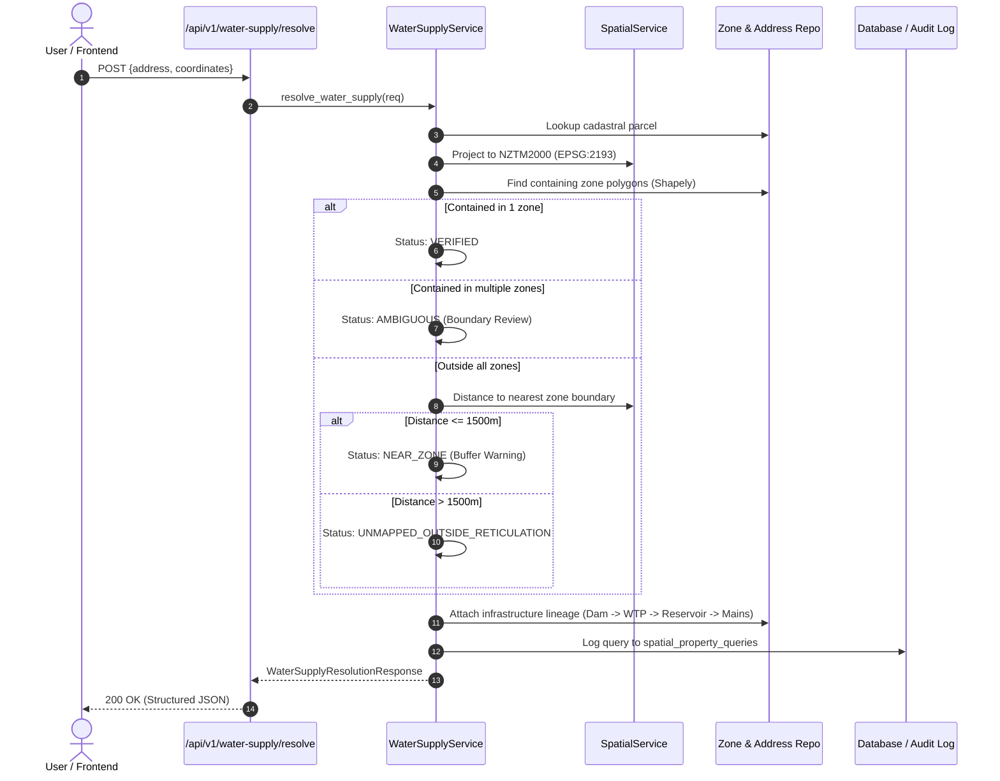

# Taumata Arowai GIS Platform - Backend Architecture

## 1. Architectural Overview

The backend for the **Taumata Arowai GIS Platform** is designed as a modular, high-performance spatial REST API adhering to Clean Architecture principles. It bridges the existing React 19 frontend with authoritative drinking water registers, spatial supply zone boundaries, and physical reticulation network telemetry.

```text
┌────────────────────────────────────────────────────────┐
│                   CLIENT PRESENTATION                  │
│       React 19 + TypeScript + Leaflet GIS Web App      │
└───────────────────────────┬────────────────────────────┘
                            │ REST / JSON (CORS)
                            ▼
┌────────────────────────────────────────────────────────┐
│                   FASTAPI ROUTERS                      │
│   Health | Addresses | Water Supply | Zones | Assets   │
└───────────────────────────┬────────────────────────────┘
                            │ Request / Response DTOs (Pydantic v2)
                            ▼
┌────────────────────────────────────────────────────────┐
│                 BUSINESS SERVICES LAYER                │
│   • WaterSupplyResolutionService (7-Step Engine)       │
│   • SpatialService (NZTM2000 Projections & Shapely)    │
│   • AddressService (Cadastral Search & Matching)       │
│   • IncidentService (Complaint Intake & Dispatch)      │
│   • AuthService (JWT Token Issuance & Verification)    │
└───────────────────────────┬────────────────────────────┘
                            │ Domain Entities
                            ▼
┌────────────────────────────────────────────────────────┐
│               DATA REPOSITORY & PERSISTENCE            │
│   • AddressRepository                                  │
│   • ZoneRepository                                     │
│   • NetworkRepository                                  │
│   • IncidentRepository                                 │
└───────────────────────────┬────────────────────────────┘
                            │ SQLAlchemy 2.0 ORM
              ┌─────────────┴─────────────┐
              ▼                           ▼
┌───────────────────────────┐ ┌───────────────────────────┐
│ Standalone Spatial SQLite │ │   Production PostgreSQL   │
│    (water_services.db)    │ │   + PostGIS (schema.sql)  │
└───────────────────────────┘ └───────────────────────────┘
```

---

## 2. Layer Responsibilities

### 2.1 API Controllers (`backend/app/api/routes/`)
- Thin controllers responsible for input unpacking, dependency injection, and HTTP status code mapping.
- Strictly validates inputs via Pydantic schemas.
- Handles authorization checks via FastAPI dependency injection (`require_official_or_admin`).

### 2.2 Core Business Services (`backend/app/services/`)
- **`water_supply_service.py`**: Executes the 7-step authoritative address resolution workflow.
- **`spatial_service.py`**:
  - Implements the official LINZ WGS84 (EPSG:4326) to NZTM2000 (EPSG:2193) Transverse Mercator projection formulas.
  - Executes sub-millisecond point-in-polygon containment using GEOS via Shapely.
  - Evaluates concentric distance buffers (50m, 100m, 200m, 500m, 1500m).
- **`incident_service.py`**: Handles water quality incident intake, tracking number generation (`NZ-DW-YYYY-XXXX`), official investigation status transitions, and statutory CSV export formatting (RFC 4180 with UTF-8 BOM, merging citizen addresses, supply zone lineages, treatment plants/dams, and contact info under strict `official`/`admin` authorization).
- **`auth_service.py`**: Handles bcrypt password verification and JWT claim signing.

### 2.3 Repositories (`backend/app/repositories/`)
- Abstraction layer isolating business logic from direct database SQL queries.
- Manages cached spatial representations and fallback mechanisms.

### 2.4 Database Engine (`backend/app/db/`)
- Declarative models reflecting `database/schema.sql`.
- Pre-seeded standalone SQLite database file (`backend/app/db/data/water_services.db`) for immediate zero-config operation.
- Seamless compatibility with production PostgreSQL / PostGIS databases via `DATABASE_URL`.

---

## 3. The 7-Step Authoritative Resolution Engine



---

## 4. Security & Data Governance

1. **Role Isolation**:
   - `citizen`: Read-only public access to schemes, compliance status, and boundary summaries. Engineering fields (`cctv_condition_score`, `invert_depth_m`, `engineer_notes`) are automatically redacted.
   - `official`: Unredacted access to pipe conditions, depth, notes, and complaint investigation tools.
   - `admin`: Administrative governance and audit log access.
2. **CORS Governance**: Whitelisted strictly to local and forwarded frontend development ports (`3000`, `5173`, `4173`).
3. **Audit Trails**: All property resolution queries are logged with coordinates, response time, and matched zone IDs.

---

## 5. Automated Verification & Testing

The backend includes a comprehensive **36-test suite** running under `pytest` in `backend/tests/`:
- **`test_health.py`**: Uptime diagnostics and readiness probes.
- **`test_auth.py`**: JWT authentication, salted Bcrypt hashing, role claim validation.
- **`test_spatial.py`**: LINZ NZTM2000 projections, Haversine distance, GEOS point-in-polygon containment, and buffer tiers.
- **`test_water_supply_resolution.py`**: 7-step deterministic supply zone and infrastructure resolution pipeline.
- **`test_address_search.py`**: Cadastral parcel search, lot matching, and boundary retrieval.
- **`test_zones_and_assets.py`**: Supply zones, schemes, and field-level telemetry redaction (CCTV and depth scores).
- **`test_incidents.py`**: Incident reporting, dispatch status updates, and authenticated CSV incident export RBAC checks.
